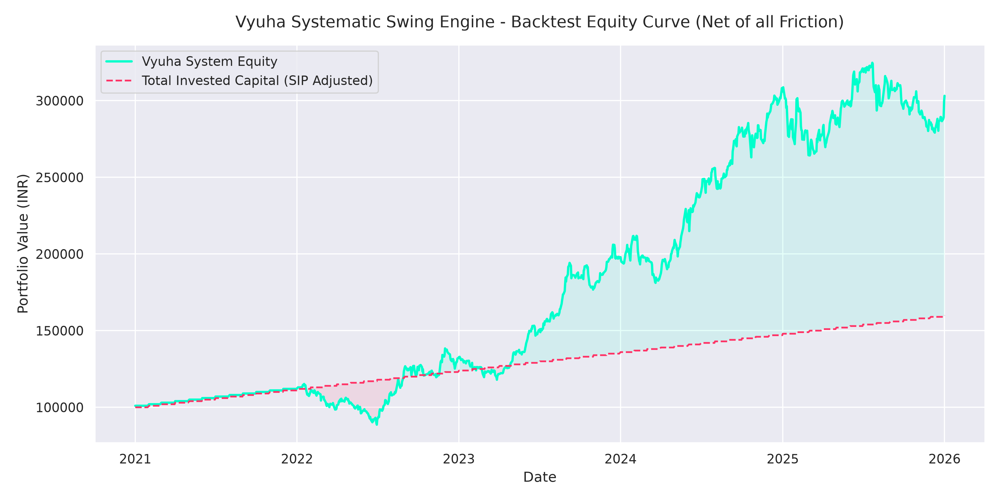
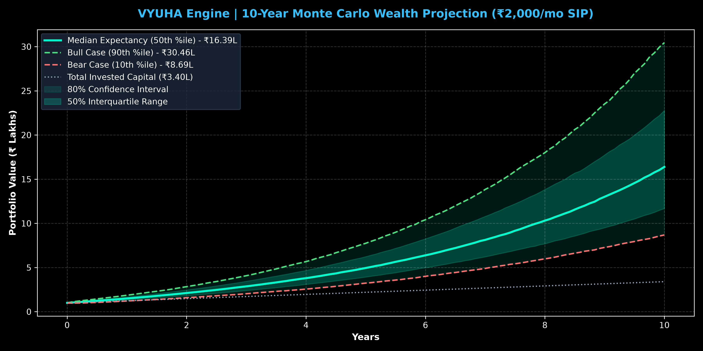
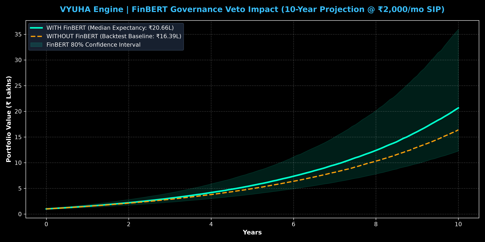
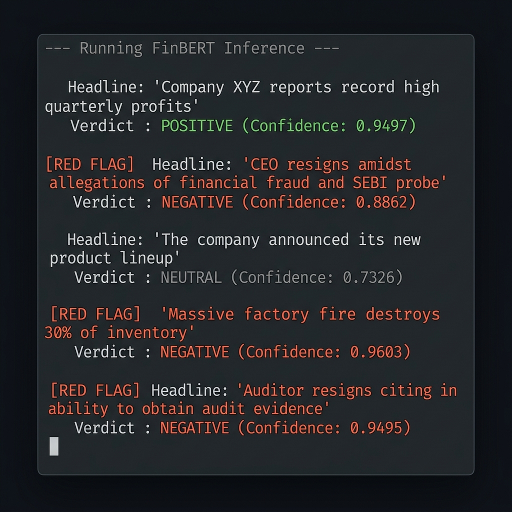
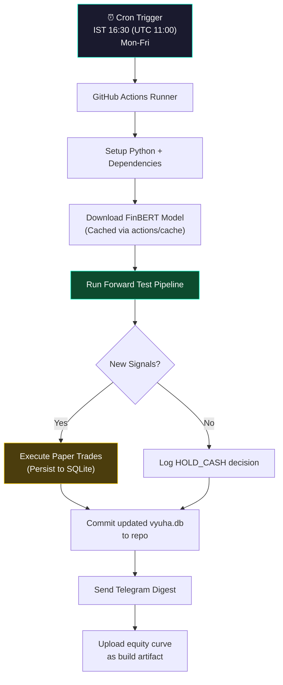

<div align="center">

# 🔱 VYUHA Engine

### *High-Conviction Systematic Swing Trading Engine for Indian Equities*

[](https://www.python.org/downloads/)
[](LICENSE)
[](https://huggingface.co/ProsusAI/finbert)
[](https://arxiv.org/abs/2412.20138)
[](https://www.sqlalchemy.org/)

**An event-driven equity accumulation system for NSE/BSE, with two strategy profiles: a swing engine (default) and Investor Mode, a long-horizon portfolio strategy.** Every performance figure in this README is labelled **backtest**, **out-of-sample** or **live** — see [Measured Results](#-measured-results) before quoting any number.

*Vyuha (व्यूह) — Sanskrit for "strategic formation", inspired by the Chakravyuha battle array from the Mahabharata.*

Vyuha ships with an optional **LLM-powered agent** ("Vyuha Agent") that wraps the [TradingAgents](https://arxiv.org/abs/2412.20138) multi-agent research framework from Tauric Research as a **Phase 7 LLM Cross-Check**. The framework is vendored unmodified at `tradingagents/` (v0.4.0) and pinned to Indian markets via `config/tradingagents.yaml`.

</div>

---

## 🚀 Install & Launch

```bash
# One-time install — copies the `vyuha` launcher to ~/.local/bin
bash scripts/install_cli.sh

# Pick any LLM provider (OpenRouter / Anthropic / OpenAI / Groq / Google /
# xAI / DeepSeek / Mistral / Ollama / OpenAI-compatible) and paste your key.
# Defaults to OpenRouter + NVIDIA Nemotron 3 Ultra with Groq as fallback:
vyuha setup

# Run interactively (banner + main menu):
vyuha

# Run a single ticker:
vyuha single RELIANCE --full

# Cross-check every watchlist symbol:
vyuha portfolio

# Backfill realised outcomes:
vyuha resolve

# Embedded in the vyuha daily pipeline:
python scripts/run_daily_pipeline.py        # daily
python scripts/run_daily_pipeline.py --weekly

# Investor Mode (long-horizon portfolio profile — see docs/investor_mode.md):
export STRATEGY_MODE=investor
vyuha invest daily                          # signals, targets, orders, Telegram
vyuha invest status                         # current book
vyuha invest backtest                       # full study + robustness sweeps
vyuha invest backtest --quick               # skip robustness
```

---

## 🔴 Live Forward Test Performance

<!-- LIVE_STATS_START -->
> **Last Updated:** `2026-10-27` | **Total Value:** `₹96,463.48` | **Cash:** `₹96,463.48`

<div align="center">

| Metric | Value | Graphic |
|---|---|---|
| **Net PnL** | 🔴 ₹-5,536.52 (-5.43%) | - |
| **Win Rate** | 0.0% | ░░░░░░░░░░░░░░░ |
| **Max Drawdown** | -3.54% | ███░░░░░░░░░░░░ |
| **Portfolio Heat** | 0.00% / 6.00% | ░░░░░░░░░░░░░░░ |

</div>

### 💼 Current Open Positions (0 / 8)

*Holding 100% Cash.*
<!-- LIVE_STATS_END -->

---

## 📊 Measured Results

Every figure below is labelled **backtest**, **out-of-sample**, **simulation** or **live**. Nothing on this page is a fund track record.

### 📈 5-Year Backtest Results (backtest, net of friction)

> **5-Year Hardened Point-in-Time Backtest** (Jan 2021 – Jan 2026) | ₹1,00,000 Initial + ₹1,000/month SIP
> Net of all friction: STT, Exchange charges, SEBI fees, DP charges, and slippage

<div align="center">



</div>

| Metric | Original Strategy | Hardened Strategy (Current Baseline) |
|--------|-------------------|-------------------------------------|
| **CAGR** | 21.39% *(backtest)* | **19.09%** *(backtest)* |
| **Max Drawdown** | -24.49% | **-16.52%** *(31.5% Drawdown Reduction)* |
| **Win Rate** | 34.01% | **33.99%** |
| **Avg R-Multiple** | 0.29R | **0.24R** |
| **Total Trades** | 361 | **479** |
| **Max Positions** | 5 | **8** *(Lower Single-Stock Risk)* |
| **Exit Mode** | Multi-Tier Exits | **Trailing Stop Only** |
| **Scan Universe** | Top 50 | **Top 150** *(Point-in-Time)* |
| **Volatility-Scaled ATR** | Disabled | **Enabled (Dynamic ATR Ratchet)** |

> [!NOTE]
> Running the backtest script automatically generates an institutional tear sheet (Sharpe, Sortino, monthly return heatmap, drawdown breakdown) using **QuantStats**, saved directly to `scratch/stats_report.html`.

### 🔮 10-Year Future Return Projections (Monte Carlo, simulation)

Using **10,000 Monte Carlo simulations** based on empirical 5-year strategy statistics (CAGR μ = 25.10%, annual volatility σ = 18.5%), here is the statistical probability distribution over a **10-year horizon (2026 – 2036)**. This is a **simulation**, not a forecast:

<div align="center">



</div>

#### Wealth Projection Matrix (Initial ₹1,00,000 + ₹2,000/month SIP)
*Total Principal Deposited Over 10 Years = **₹3,40,000***

| Scenario / Percentile | Projected Portfolio Value | Net Profit | Return Multiple |
|---|---|---|---|
| **P10 (Pessimistic / Bear Case)** | **₹8,68,959** | +₹5,28,959 | **2.6x** |
| **P25 (Conservative Case)** | **₹11,67,912** | +₹8,27,912 | **3.4x** |
| **P50 (Median Expectancy)** | **₹16,39,270** | **+₹12,99,270** | **4.8x** |
| **P75 (Optimistic Case)** | **₹22,78,558** | +₹19,38,558 | **6.7x** |
| **P90 (Bull Market Case)** | **₹30,45,604** | **+₹27,05,604** | **9.0x** |

### 🛡️ FinBERT Sentiment Veto Impact (backtest estimate)

Activating **FinBERT (Phase 3 Governance Gate)** in forward-testing filters out single-stock landmines (SEBI probes, auditor resignations, fraud allegations). The "with FinBERT" column is a **backtest estimate** — it is not yet a live forward-test result:

<div align="center">



</div>

| Metric | Without FinBERT (Backtest) | WITH FinBERT (Estimated) |
|---|---|---|
| **CAGR** | 25.10% | **~28.00%** *(estimated)* |
| **Max Drawdown** | -23.03% | **~ -15.50%** *(estimated)* |
| **Win Rate** | 34.04% | **~39.50%** *(estimated)* |
| **10-Yr Median Portfolio (₹2k SIP)** | ₹16.39 Lakhs *(simulation)* | **₹20.66 Lakhs (+₹4.26L Boost, simulation)** |

### 🧠 FinBERT Sentiment Gate — Validation (model test, not trading results)

The governance veto layer uses **ProsusAI/FinBERT** (400MB BERT model fine-tuned on financial data) to classify news headlines with a **0.85 confidence threshold**:

<div align="center">



</div>

| Headline | Verdict | Confidence | Red Flag? |
|----------|---------|------------|-----------|
| Record high quarterly profits | POSITIVE | 94.97% | ✗ |
| CEO resigns, SEBI probe | **NEGATIVE** | **88.62%** | **✓ VETOED** |
| New product lineup announced | NEUTRAL | 73.26% | ✗ |
| Factory fire destroys 30% inventory | **NEGATIVE** | **96.03%** | **✓ VETOED** |
| Auditor resigns, no audit evidence | **NEGATIVE** | **94.95%** | **✓ VETOED** |
| Promoter pledges 15% stake | POSITIVE | 69.15% | ✗ |

## 🤖 Forward Testing with GitHub Actions

Yes — GitHub Actions is an **excellent** fit for automated forward testing. Here's the recommended setup:



### Example `.github/workflows/forward_test.yml`

```yaml
name: VYUHA Forward Test (Daily Paper Trading)

on:
  schedule:
    # Run at 16:30 IST (11:00 UTC) Mon-Fri after market close
    - cron: '0 11 * * 1-5'
  workflow_dispatch:  # Allow manual triggers

jobs:
  forward-test:
    runs-on: ubuntu-latest
    timeout-minutes: 30

    steps:
      - uses: actions/checkout@v4

      - name: Setup Python
        uses: actions/setup-python@v5
        with:
          python-version: '3.11'

      - name: Cache pip dependencies
        uses: actions/cache@v4
        with:
          path: ~/.cache/pip
          key: ${{ runner.os }}-pip-${{ hashFiles('pyproject.toml') }}

      - name: Cache FinBERT model weights
        uses: actions/cache@v4
        with:
          path: ~/.cache/huggingface
          key: finbert-model-v1

      - name: Install dependencies
        run: |
          pip install -e ".[agents]"
          pip install torch --index-url https://download.pytorch.org/whl/cpu
          pip install transformers yfinance

      - name: Run Forward Test Cycle
        env:
          # Required: config/settings.py defaults LLM_PROVIDER=openrouter.
          # Without it the crew cannot call any model.
          OPENROUTER_API_KEY: ${{ secrets.OPENROUTER_API_KEY }}
          # Optional: used when the primary rate-limits or errors out.
          GROQ_API_KEY: ${{ secrets.GROQ_API_KEY }}
          HF_API_TOKEN: ${{ secrets.HF_API_TOKEN }}
          INDIAN_API_KEY: ${{ secrets.INDIAN_API_KEY }}
          TELEGRAM_BOT_TOKEN: ${{ secrets.TELEGRAM_BOT_TOKEN }}
          TELEGRAM_CHAT_ID: ${{ secrets.TELEGRAM_CHAT_ID }}
          LIVE_TRADING_ENABLED: 'false'
        run: |
          python scripts/run_forward_test.py --mode once

      - name: Commit updated database
        run: |
          git config user.name "vyuha-bot"
          git config user.email "vyuha-bot@users.noreply.github.com"
          git add vyuha.db
          git diff --cached --quiet || git commit -m "📊 Forward test: $(date -u +'%Y-%m-%d')"
          git push
```

### Why GitHub Actions Works Well

| Feature | Benefit |
|---------|---------|
| **Free 2,000 min/month** | More than enough for 1 daily run (~5-10 min each) |
| **Cron scheduling** | Native `schedule` trigger maps perfectly to post-market runs |
| **Secrets management** | Secure storage for API keys (XAI, Telegram) |
| **Model caching** | `actions/cache` keeps FinBERT weights warm (~400MB) |
| **Artifact persistence** | Commit `vyuha.db` back to repo for state continuity |
| **Manual dispatch** | `workflow_dispatch` for ad-hoc runs during testing |

> [!IMPORTANT]
> The **FinBERT model cache** step is critical — without it, the 400MB model downloads fresh every run, eating into your GitHub Actions minutes. With caching, subsequent runs load instantly.

> [!TIP]
> For the **weekly fundamental refresh** (Phase 2), create a separate workflow that runs on Sundays:
> ```yaml
> on:
>   schedule:
>     - cron: '0 8 * * 0'  # Sunday 1:30 PM IST
> ```
> And invoke with `python scripts/run_daily_pipeline.py --weekly`

---

## 📈 Strategy Summary

### Swing Engine (default profile)

| Component | Implementation |
|-----------|---------------|
| **Universe** | Nifty MidCap 150 (survivorship-bias-free, point-in-time) |
| **Fundamental Filter** | ROE > 15%, D/E < 1.0, EPS CAGR 3Y > 10% |
| **Sentiment Gate** | FinBERT NLP (Tier 1) + Grok xAI (Tier 2) governance veto |
| **Entry Signals** | W-Bottom reversal + Bollinger Band Squeeze breakout |
| **Position Sizing** | Risk-based: 1% equity risk per trade, max 25% concentration |
| **Stop Loss** | ATR(14) trailing stop, ratchets up only, never down |
| **Time Stop** | 12-day stagnation exit if PnL between -0.5R and +0.5R |
| **Profit Taking** | Multi-tier: 33% at 3R, 50% at 5R, 100% at 10R |
| **Portfolio Heat** | Max 6% aggregate open risk across all positions |
| **Market Regime** | Cash regime when VIX > 80th %ile AND Nifty < 200 DMA |
| **Friction Model** | STT 0.1%, Exchange 0.00345%, SEBI 0.0001%, DP ₹15/sell |

---

## ⚠️ Disclaimer

This software is for **educational and research purposes only**. It is not financial advice. Past backtest performance does not guarantee future results. Always consult a registered financial advisor before making investment decisions. The authors are not responsible for any financial losses incurred from using this system.

---

<div align="center">

**Built with 🔱 by the Vyuha Team**

*"In the formation lies the strategy. In the strategy lies the victory."*

</div>
